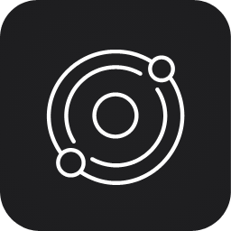

<p align="center"></p>

# Light Studio

Planificador de luz para fotografía de paisaje y noche: Sol, Luna, Vía Láctea, eclipses, sombras del terreno,
horizonte de montañas, alineaciones y puntos de interés sincronizables con el móvil.
*A light planner for landscape and night photography.*

## Qué incluye

- **Planificador**: salida/puesta del Sol y la Luna, horas dorada y azul, ventana de la Vía Láctea, calendario del cielo y vista anual. La zona horaria y el horario de verano se resuelven sin conexión para cualquier lugar del mundo.
- **Mapa**: mapa o satélite, contaminación lumínica, sombras del terreno, horizonte de montañas, herramienta de cámara (campo de visión y profundidad de campo) y cristal esmerilado bajo las tarjetas.
- **Mapa sin conexión**: usa un archivo PMTiles ráster (Ajustes ▸ Mapa) cuando no hay red.
- **Relieve fino (prototipo)**: carpeta de LiDAR de 1 m (.asc, ETRS89 UTM 30N) para afinar las sombras en Gipuzkoa; fuera de la zona cubierta se usa el relieve global.
- **Satélites**: pasadas visibles de la ISS y otras estaciones espaciales (órbitas de CelesTrak) y tránsitos por el Sol y la Luna con su duración, en la pestaña Noche.
- **Búsqueda de alineaciones** (Sol/Luna/núcleo galáctico con un punto del terreno) y **eclipses**, validados al minuto con el eclipse total del 2 de agosto de 2027.
- **Cálculos**: exposición, NPF, time-lapse, filtros ND, trazas de estrellas.
- **Planes y puntos de interés** guardados, con exportación a Calendario (macOS) y sincronización con la app web del móvil (PDI).
- **Modo luz roja** para conservar la visión nocturna en el campo, y opción de reducir el movimiento.
- Interfaz en español e inglés.
- Crate `light-studio-astro`: astronomía propia (teoría lunar de Meeus, ΔT, paralaje topocéntrica, refracción, eclipses), sin dependencias externas.

## Web

[lightstudio.luisnietofoto.com](https://lightstudio.luisnietofoto.com)

## Compilar

```sh
cargo run --release -p light-studio
cargo test
```

### .dmg para macOS

```sh
./scripts/make-dmg.sh            # para el chip de este Mac
./scripts/make-dmg.sh universal  # Apple Silicon + Intel
```

Genera `dist/Light-Studio-<versión>.dmg` (firma ad hoc; la primera vez, clic derecho ▸ Abrir).

Requiere Rust 1.90 o superior. Solo para macOS.

## Variables de entorno (opcionales)

`LIGHT_STUDIO_CONFIG_DIR`, `LIGHT_STUDIO_MAP_TILES`, `LIGHT_STUDIO_ELEVATION_URL`, `LIGHT_STUDIO_GEOCODE_URL`,
`LIGHT_STUDIO_TERRAIN_URL`, `LIGHT_STUDIO_OVERPASS_URL`, `LIGHT_STUDIO_PDI_KEY`.

## Licencia

MIT © Luis Nieto. Ver [LICENSE](LICENSE).
